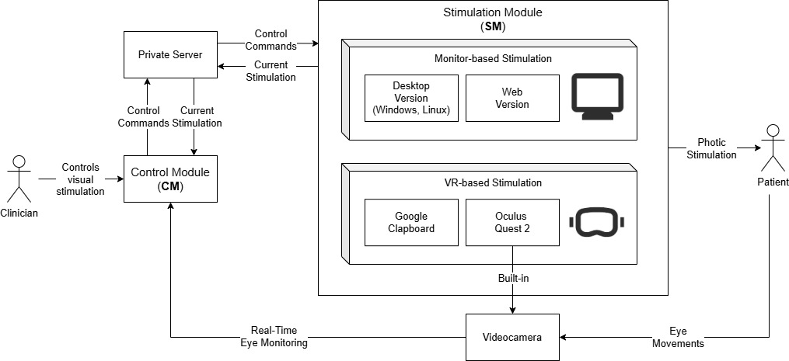

# VRPhotosense2: Virtual Reality System for Photic Stimulation for Photosensitive Diagnosis
Clinical visual stimulation tool to provide richer photic stimulation for photosensitivity diagnosis.
This application offers configurable color stimuli, static and fast-moving patterns, and photoprovocative video segments to be played on both VR- and monitor-based devices. 

## License
This project is licensed under the GNU General Public License v3.0 (GPL-3.0). See the [LICENSE](LICENSE) file for details.

## Main features
- Clinically relevant visual stimuli:
	- Flashing lights:
		- configurable flash color,
		- configurable background color.
	- Photoprovocative patterns:
		- static screening, 
		- configurable oscillatory motions.
	- Photoprovocative video segments:
		- real-world visual triggers,
		- associated with historically documented epileptic crisis.
- Two interconnected modules:
	- Stimulation Module: 
		- stimuli screening in device.
		- Availbale in:
			- Web app (for conventional monitor),
			- Windows and Linux desktop app (for conventional monitor),
			- APK package (for VR headsets and smartphones).
	- Control Module:
		- stimuli creation,
		- stimuli configuration, 
		- eye movement monitoring,
		- screening monitoring,
		- automatic rearranging depending on window size,
		- control of stimulation prodecure:
			- play stimulus,
			- pause stimulus,
			- resume stimulation,
			- stop stimulus,
			- repeat stimulus,
			- skip stimulus,
			- continuous looping.
		- Available in:
			- Publicly open private server
			
## Project structure
```
VRPhotosense2/
├── server/
├── vrphotosenseApp/
│   ├── Assets/
│   ├── Packages/
│   └── ProjectSettings/
├── vrphotosenseAppOculus/
│   ├── Assets/
│   ├── Packages/
│   └── ProjectSettings/
├── LICENSE
└── README.md
```

## Application Modules
The application if formed by two interconnected modules: the Control Module and the Stimulation Module. Both connect to each other through a private and secure server.

### 1. Stimulation Module
Plays the current stimulus to the subject through the stimulation device, which can be a secondary monitor, a VR headset or a smartphone. 
The monitor version is available both as a web application, and as a standalone desktop application for Windows and Linux. 
The VR and smartphone versions are available as APK packages.

### 2. Control Module
Allows to control the stimulation procedure from a primary monitor. It provides real-time monitoring of the patient's eyes and the current stimulus being played to the subject, as well as playback controls for managing the stimulation (start previous onset, stop, pause, start next onset, loop).
All stimuli are organized in tabs dedicated to each type of stimulation (flashing lights, pattenrs, oscillatory motions, and videos). In each tab, new stimuli can be created and existing ones can be configured: 
- For flashing-light stimuli, parameters such as frequency sequence, stimulation and resting intervals, and foreground and background colors can be adjusted. 
- For moving patterns, the speed, direction, and visual pattern to use can be configured for each type of movement.
- For static patterns and videos, new files can be uploaded.

### 3. Publicly Open Private Server
Both modules synchronize through a Server: the Control Module sends the Stimulation Module the chosen stimulus to be played on the stimulation device, as well as the playback commnads to control the screening. 
The Server is privately hosted but publicly available for client access through the following link: https://visir.edv.uniovi.es. 
All communications are secured using HTTPS with valid TLS/SSL certificates.



## Installation
Both modules are accessible through the link above. 
When accessed, the Control Module is directly opened on the browser. From there, the appropriate version of the Stimulation Module can be downloaded for the target stimulation hardware. 

### Option 1: Monitor Version
For monitor-based stimulation, three options are available:
- A desktop application for Windows. It will download the file ```"vrphotosenseApp.exe"```, which does not require any installation.
- A desktop application for Linux. It will download the file ```"vrphotosenseApp.x86_64"```, which does not require any installation.
- The web application, which requires no download or installation; it can be executed directly on the browser.

All versions can be used in Windowed or Full-screen mode. The display will automatically rearrage itself depending on the size.

### Option 2: VR / Smartphone Version
For VR-based stimulation, two options are available:
- An application for the Oculus Quest 2 headset.
- An application for Android smartphones.  

Both versions are distributed as APK packages that must be downloaded and installed on the target device prior to use.


## Execution
To run the application, the following steps are required:
- When the Control Module is launched, it prompts the user to configure a local folder where all pattern and video files will be stored.
- When the Stimulation Module is launched, it generates and displays a pairing code required to establish the connection with the Control Module.
- After the local folder has been configured, the Control Module prompts the user to enter the pairing code displayed by the Stimulation Module to complete the connection.

